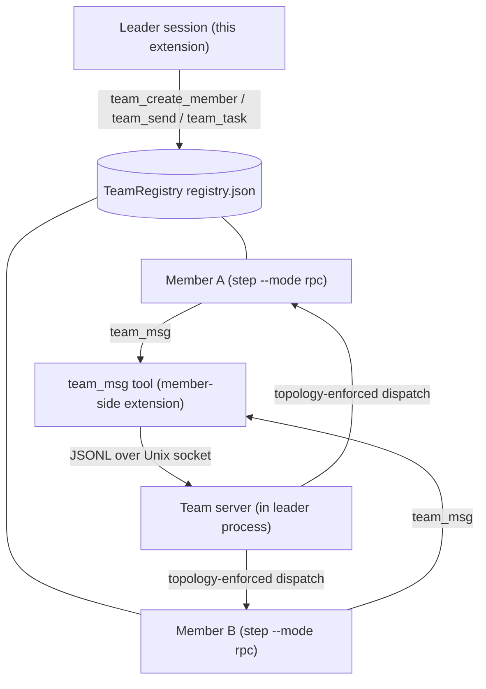
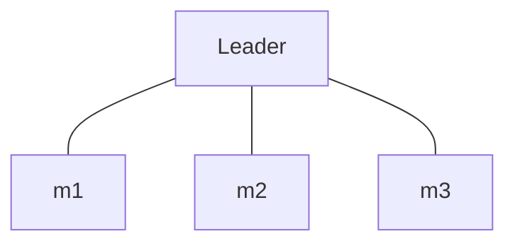
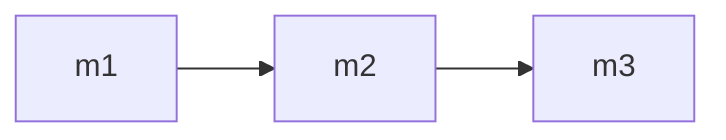
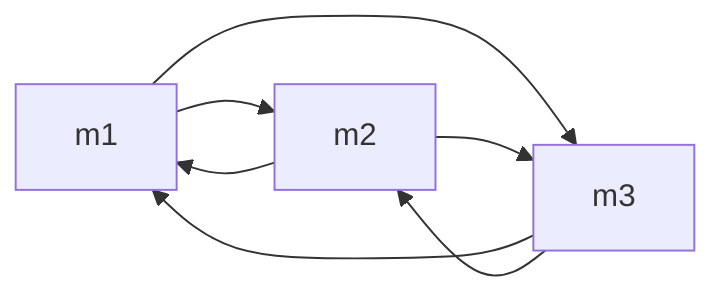
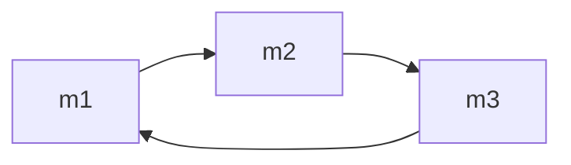
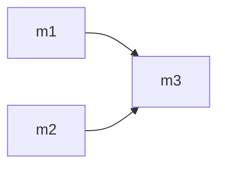

# Step-Code-Agent-Team

[简体中文说明 →](./README_CN.md)

Agent team plugin for [Step Code](https://github.com/stepfun-ai/Step-Code) (`step`): your current session becomes a **leader** that spawns resumable **member** agents, decomposes goals into a dependency-aware **task board**, dispatches work in parallel, and lets members message each other directly.

> **Reference:** This project references the **agent teams feature of DeepSeek Harness** — the leader/member model, the dependency-aware task board, and member-to-member messaging follow its design. It is an independent implementation for Step Code and is not affiliated with DeepSeek.

> **⚠️ Cost warning:** every team member is a full agent process with its own
> context window, running on the conversation's current model (effort per
> role preset: `scout`=low, `planner`/`worker`=medium, `reviewer`=high; `high`
> when no preset applies). N members working in parallel cost roughly N× a
> single conversation
> turn, and long member runs accumulate quickly. The plugin tracks cumulative
> team spend and warns at `cost.warnThreshold` (default $1, 0 disables) — watch
> `team_status`, and disband idle members when the work is done.

## How it works



- **Members are real `step` processes** with their own context window, model, and tool allowlist, spoken to over the RPC protocol. A member's context lives in its session file, so respawning it with the same session id resumes the conversation.
- **The task board is a DAG**: a task is `ready` when every task in its `blockedBy` is `done`; cycles are rejected.
- **Messaging**: members reach teammates through the built-in `team_msg` tool, which talks to a Unix socket served by the leader process. Direct messaging is gated by the declared topology (see below); the default star routes everything through the leader. The tool needs no shell — read-only presets (`scout`/`planner`/`reviewer`) keep their posture and their topology edges stay usable. The `stepcode-team` CLI shim remains for manual/external use.
- **Guardrails**: max 8 live members (disbanded or reaped members no longer count against the limit), max 5 concurrent dispatches (queue-before-start), 180s per-dispatch timeout, cumulative-spend warning (`STEPCODE_TEAM_COST_WARN`, default $1), idle members reaped after 30 min (sessions stay resumable), all children killed on leader shutdown.

## Requirements

- The `step` CLI on your PATH.
- Node (the `step` runtime; the optional `stepcode-team` shim is invoked as `node bin/stepcode-team.mjs`).
- No third-party npm dependencies.

## Install

```bash
# Dev loop: load the extension straight from a checkout, no install
step -e ./extensions/index.ts

# Try the full package (extension + skill + prompt) without installing
step -e /absolute/path/to/Step-Code-Agent-Team

# Install from a checkout — records the path in your step settings
step install /absolute/path/to/Step-Code-Agent-Team
step remove /absolute/path/to/Step-Code-Agent-Team  # uninstall (same path)
```

Local-path installs are **reference-only**: step records the path in your step
configuration and loads the package's declared resources (the `pi` manifest
in `package.json`: `extensions/` — the plugin ships no skills or prompt
templates; orchestration guidance is injected request-locally and the review
workflow is the `/topo review` command) from it — nothing is
copied, so `local/` (credentials) and `sandbox/` (dev state) are never involved.
Use an absolute path (relative paths resolve against the step config file's
directory, not your shell's cwd), and note the entry breaks if the checkout
moves. Add `-l` to install project-locally instead (the project's `.stepcode/`
config, shared with your team, auto-installed once the project is trusted).

From git or npm — no packaging step needed, it is a standard step package:

```bash
step install git:github.com/CTCingithub/Step-Code-Agent-Team@latest # latest release (recommended)
step install git:github.com/CTCingithub/Step-Code-Agent-Team@v0.2.0 # or pin a version
step install npm:step-code-agent-team                               # once published to npm
```

Then start a session and ask: *"Use an agent squad to review this repo in parallel."* — or run `/topo` first; the plugin stays dormant until then.

## Activation (default off)

The plugin is **inactive when a session starts**: the team tools are hidden from
the model, and no server, timer, or member process exists. It activates when:

1. You invoke the **`/topo`** command (activates and shows the team board), or
2. Your prompt explicitly mentions the plugin (keyword list below, configurable).

Once activated it stays on for the session. **`/topo off`** turns it off again
and re-hides the team tools — the escape hatch for a misfired activation
(member sessions stay resumable). **Migration:** the `/agent-team` alias was
removed in 0.2.0 — `/topo` is the only command. Deprecated activation keywords
(the old "agent team" / "智能体团队" / "组队" style terms) are stripped from the
effective keyword list on load, so a future official agent-teams feature is
never shadowed; the stripped terms are reported once on activation. Your
config file is never rewritten.

### Activation keywords (0.2.0 defaults)

Only plugin-specific keywords activate the plugin. The bare "agent team" /
"智能体团队" / "组队" style words were deliberately dropped in 0.2.0 so a
future official agent-teams feature cannot collide with this plugin:

```text
智能体小队 · 多智能体小队 · 组小队 · stepcode 小队 · topo team · topo-agent ·
stepcode topo · topology team · agent squad · stepcode-agent-team ·
step code agent team · team_create_member · team_send · team_task
```

(14 terms; tune via `activation.keywords` — see
[docs/CONFIGURATION.md](docs/CONFIGURATION.md).)

### False-trigger guard (default on)

Keyword activation passes through three guard layers — slash commands bypass
them all, since an explicit command is always honored:

- **L1 — heuristic veto** (`activation.guardEnabled`): a hit reading as
  negation ("don't use an agent squad"), meta-discussion ("what is
  `team_task`"), or a code reference (backticks, imports, calls) does not
  activate.
- **L2 — TUI confirmation** (`activation.confirmBeforeActivate`): the
  interactive TUI asks before a keyword hit activates.
- **L3 — headless/RPC auto-activation** (`activation.headlessAutoActivate`):
  scripted runs activate directly on a keyword hit — nobody can answer a
  dialog there.

All three default to `true`.

## Team plans (default off)

Opt-in team *strategies*. With `plan.enabled = true`, activating via `/topo`
offers a picker — or applies a pinned strategy directly:

```toml
# ~/.stepcode/config.toml (or <project>/.stepcode/config.toml)
[stepcodeAgentTeam.plan]
enabled = false
tier = "always ask"   # always ask | economic | fast | balanced | performance
```

| Strategy | Statement |
|---|---|
| Economic | Lowest cost: few members, low effort, skip unnecessary stages |
| Fast | Shortest wall time: start in parallel immediately |
| Balanced *(fallback when no choice is made)* | Balance cost and quality across exploration, planning, execution, and review |
| Performance | Highest quality regardless of cost: many members, high effort |

A tier is a **strategy prompt, not a fixed roster**: the instruction states the
strategy and offers a non-binding example (e.g. "1 scout + 1 worker, effort
low/medium, star topology"), and the leader model decides the actual members,
roles, topology, and effort from the task. The picker's fifth entry —
**custom requirements** — runs a short guided flow (team size → topology →
effort) and carries your free-text requirements along with the request.

Picker behavior: options are localized (an English request sees
Economic/Fast/Balanced/Performance); a 30s timeout falls back to the
`balanced` strategy; headless/RPC activations skip the picker and apply it
directly. With `plan.tier` pinned to a strategy, every activation — `/topo`
or a keyword hit — applies it without asking; `/topo <tier>` still overrides
per invocation.

## Tools

| Tool | Purpose |
|---|---|
| `team_create_member` | Create/resume a member (`name`, optional `role` preset, `model`, `effort`, `tools`, `systemPrompt`) |
| `team_send` | Message a member and wait for the full reply; optional `taskId` (runs it as a task) or `mode: "oneshot"` (stateless) |
| `team_task` | Task board: `create` / `start` / `complete` / `fail` / `list` |
| `team_status` | Members, task board, cumulative spend |
| `team_disband` | Stop one member or the whole team (sessions persist) |
| `team_set_topology` | Declare the member messaging topology (`star`/`pipeline`/`mesh`/`ring`/`custom`) before dispatching work |
| `/topo` | Command: activate the plugin and show the team board. `/topo off` deactivates and re-hides the team tools; `/topo <tier>` (economic/fast/balanced/performance/custom) applies a team strategy (see Team plans); `/topo review [target]` runs the parallel multi-reviewer protocol; text after the command is forwarded to the agent **verbatim** — the "use the team" instruction is injected request-locally through a context event and never written to the session file |

## Member communication topology

Direct member-to-member messaging is **denied unless the topology allows it**. The leader designs the topology that fits the task with `team_set_topology` after creating members and before dispatching work; the default is a star, where everything routes through the leader.

> **Read-only roles and topology edges:** every member — including the read-only presets (scout/planner/reviewer) and custom roles without `bash` — messages teammates through the built-in `team_msg` tool, so topology edges are usable for every role. Express dependencies with the task board's `blockedBy`; the `stepcode-team` CLI shim remains available for manual use.

| Shape | Edges | Fits |
|---|---|---|
| `star` (default) | none | Independent parallel strands that the leader merges |
| `pipeline` | m1→m2→…→mn (creation order) | Sequential refinement (scout → planner → worker → reviewer) |
| `mesh` | all ordered pairs | Peers cross-checking each other |
| `ring` | mi→mi+1 (wraps around) | Round-robin review; chain length bounded by `topology.maxLoopCount` (default 2, 0 = unlimited) |
| `custom` | explicit `{from, to}` list | Precise control |

**`star` (default)** — no member↔member edges; the leader relays everything:



**`pipeline`** — ordered handoffs in member creation order:



**`mesh`** — every member may message every other member:



**`ring`** — each member may message the next (wraps around); the message chain is bounded by `topology.maxLoopCount` (default 2, 0 = unlimited):



**`custom`** — explicit `{from, to}` edges:



Enforcement lives in the team server: every message carries its sender (injected at spawn time) and is checked against the declared edges; violations are rejected with the sender's allowed neighbors (a `team_msg` rejection lists them; `stepcode-team status` reports the same). In a ring, each forwarded message extends the sender's chain by one hop; a hop that would exceed `topology.maxLoopCount` (default 2, 0 = unlimited) is rejected and the sender is told to report to the leader instead — which also prevents ring-circulation deadlocks. Set `topology.requireDeclaration: true` in the config to block all dispatches until the topology is explicitly declared — the literal "design before work" workflow. Full reference: [docs/CONFIGURATION.md](docs/CONFIGURATION.md).

## Role presets (`agents/` + custom roles)

| Preset | Tools | Use |
|---|---|---|
| `scout` | read-only | Codebase exploration, structured findings |
| `planner` | read-only | Implementation plans |
| `worker` | full | Executes plans, runs checks |
| `reviewer` | read-only | Adversarial review (correctness / style / security) |

Preset effort defaults: `scout`=low, `planner`=medium, `worker`=medium,
`reviewer`=high. Resolution order: an explicit `effort` argument to
`team_create_member` → the `[stepcodeAgentTeam.presets.effort]` config
override (built-in role names) → the preset's frontmatter `effort` → `high`.
While `models.autonomousThinking = true` the leader picks the effort per
member and all preset efforts are inert.

You can add your own roles — Markdown files with the same frontmatter format
in `<agentDir>/agents/` or `<project>/.stepcode/agents/` (trusted projects),
overriding bundled presets by name: see [docs/ROLES.md](docs/ROLES.md).

The parallel multi-reviewer workflow ships as the **`/topo review [target]`**
command, and the orchestration protocol is injected request-locally on
activation — no skill or prompt-template resources are shipped.

## Development sandbox

The sandbox ships with the repo and is fully isolated from your real
`~/.stepcode` config, sessions, and projects (its runtime state — agent dir,
sessions, team registries, `auth.json` — is gitignored). `sandbox/step` is a
git submodule pinning the Step Code revision this sandbox tracks; clone with
`--recurse-submodules` (or run `git submodule update --init sandbox/step`),
and see `sandbox/README.md` for the update/build workflow:

```bash
./sandbox/run.sh     # launches step with STEP_CODING_AGENT_DIR pointed at sandbox/agent
bash sandbox/probe.sh  # zero-token protocol probe (expects "PROBE OK")
bash sandbox/restore-project.sh  # reset the demo project (sandbox/project) to its seeded-bug state
```

`run.sh` sets `STEP_CODING_AGENT_DIR`, `STEP_CODING_AGENT_SESSION_DIR`, and
`STEP_CODING_AGENT_PLAN_DIR` to `sandbox/agent/...`, and runs `step` in
`sandbox/project/` (a throwaway demo workspace). Export your own `STEP_API_KEY`
in your shell before runs that touch a model — keys are never written to disk.
The LLM-layer probes (`sandbox/smoke-phase4/10/11/12.ts`) are included too; see
[docs/TESTING.md](docs/TESTING.md) and `sandbox/README.md`.

## Project layout

```
extensions/    index.ts (wiring) · config.ts · activation.ts · rpc-client.ts ·
               members.ts · tasks.ts · registry.ts · team-server.ts ·
               topology.ts · presets.ts · plan.ts · forward.ts · tools.ts ·
               member-messaging.ts · render.ts
bin/           stepcode-team.mjs (member-side CLI shim; manual/external path)
agents/        role presets (scout · planner · worker · reviewer)
docs/          ARCHITECTURE · PROTOCOL · CONFIGURATION · ROLES · TESTING ·
               TUI-VERIFICATION · MANUAL-TESTING references
test/          smoke/ zero-token probes + run-smoke.sh (npm run smoke)
sandbox/       isolated dev environment (ships with the repo; runtime state gitignored)
               └── step/  Step Code source submodule (pinned revision)
```

## Configuration

All behavior lives in the `stepcodeAgentTeam` table of Step Code's unified
config — globally in `<stepRoot>/config.toml` (beside the agent dir, default
`~/.stepcode`) and, for trusted projects, in `<cwd>/.stepcode/config.toml`.
Precedence: built-in defaults < global < project < environment overrides
(`STEPCODE_TEAM_DEBUG` · `STEPCODE_TEAM_COST_WARN` · `STEPCODE_TEAM_MAXDEPTH`).
No config file is required; on first activation the plugin appends a commented
defaults block to your global config so the options are discoverable. Config is
read once per session (`/reload` re-reads it, but also returns the plugin to its
default-off state).

```toml
# ~/.stepcode/config.toml (or <project>/.stepcode/config.toml)
[stepcodeAgentTeam.members]
max = 8
defaultRole = "worker"

[stepcodeAgentTeam.dispatch]
maxConcurrent = 5

[stepcodeAgentTeam.plan]
enabled = false
tier = "always ask"

[stepcodeAgentTeam.presets.effort]
scout = "low"
planner = "medium"
worker = "medium"
reviewer = "high"
```

Full reference (all sections, semantics, and topology shapes): [docs/CONFIGURATION.md](docs/CONFIGURATION.md).

Key points: with `autonomousSelection` off (default) every member runs on the
conversation's current model; with `autonomousThinking` off (default) members
use their preset's effort default (`scout`=low, `planner`/`worker`=medium,
`reviewer`=high), falling back to `high` without a preset.
`members.maxRecursionDepth` (default 1) bounds the
team tree — members cannot spawn sub-teams until you raise it; and
`dispatch.maxConcurrent` (default 5) caps simultaneously running members:
dispatches beyond the limit queue, and a member process is not started until a
slot frees. Full reference:
[docs/CONFIGURATION.md](docs/CONFIGURATION.md).

Environment overrides: `STEPCODE_TEAM_DEBUG=1` (≡ `debug: true`),
`STEPCODE_TEAM_COST_WARN=<usd>` (≡ `cost.warnThreshold`),
`STEPCODE_TEAM_MAXDEPTH=<n>` (≡ `members.maxRecursionDepth`, 1–4; the leader
injects the effective value into member processes).
`STEPCODE_TEAM_SOCK` is injected automatically on member processes.

## Development

Zero-token smoke probes exercise the protocol layer without any model calls
(spawn, handshake, registry, task graph, socket round-trip, presets):

```bash
bash sandbox/probe.sh   # RPC handshake probe → expects "PROBE OK"

npm run smoke           # full zero-token suite (test/smoke/phase1,2,3,5,6,7,8,9,13,14,15,16,17,18,19,20,21)
                        # hermetic: throwaway agent dir; phase 5 is skipped
                        # unless STEP_API_KEY is set (it makes one real call)
```

The suite ships in `test/smoke/` with a hermetic runner (`test/run-smoke.sh`,
temporary agent dir via mktemp). LLM-path probes (`sandbox/smoke-phase4/10/11/12.ts`)
need a test key; see [docs/TESTING.md](docs/TESTING.md) and `sandbox/README.md`.

> **Headless runs:** `step -p` blocks tools that spawn processes or modify the
> workspace unless a permission preset is configured. For unattended runs, add
> `--approval-mode auto` (or `--non-interactive-approval allow`).

## Documentation

| Document | Contents |
|---|---|
| [docs/ARCHITECTURE.md](docs/ARCHITECTURE.md) | Components, data flow, storage layout, guardrail map |
| [docs/PROTOCOL.md](docs/PROTOCOL.md) | Member RPC protocol, socket protocol, registry schema, tool contracts |
| [docs/CONFIGURATION.md](docs/CONFIGURATION.md) | Config reference |
| [docs/ROLES.md](docs/ROLES.md) | Custom roles: directories, frontmatter format, effort rules |
| [docs/TESTING.md](docs/TESTING.md) | How to run the four test layers |

## Known limitations

- **Project-level config has two timing compromises**: tool description strings built at
  registration (e.g. the model list) and this process's depth gate are not refreshed by a
  project-level override; the effective depth bound is propagated to sub-leaders via
  `STEPCODE_TEAM_MAXDEPTH`, and description changes take effect next session.
- **LLM behavior cannot be fully controlled**: members may abandon tools to investigate their
  environment; coordination prompts are hardened but this cannot be eliminated.
- **TUI rendering is not manually verified**: `render.ts` only runs in the interactive TUI,
  which headless probes do not cover.
- **LLM-path probes need your own key**: `sandbox/smoke-phase4/10/11/12.ts` and the `cfg-*`
  fixtures now ship with the repo (sandbox runtime state stays gitignored), but they make real
  model calls — export your own `STEP_API_KEY` first. The zero-token suite (`npm run smoke`)
  needs no key.
- **Depth ≥ 3 is not live-tested with a real LLM chain** (process-level self-bootstrap is
  verified; the depth bound constrains deeper trees).

## License

MIT — see [LICENSE](LICENSE).

## Platform constraints

This plugin targets **Step Code only** and uses exclusively standard extension
APIs: `pi.registerTool` / `pi.registerCommand` / `ctx.ui.notify` / tool
`renderCall` + `renderResult` (pi-tui `Text`) / `onUpdate` streaming.

It does **not** depend on the DeepSeek Harness "better sidebar" plugin — or any
other DSH-only plugin — because no such plugin exists in Step Code. If a
sidebar-like UI is ever added, it must be built on Step Code native APIs, or
sit behind an optional interface that degrades to a no-op when the dependency
is absent, so the core team functionality always runs.

## Status

0.2.0 feature set (release tag pending maintainer approval):

- **Command & activation**: `/topo` with plan tiers, `/topo review [target]`,
  and `/topo off`; plugin-specific activation keywords with forced migration
  of the retired terms; a three-layer false-trigger guard.
- **Team plans** (default off): economic / fast / balanced / performance
  strategy prompts plus a guided custom flow; `plan.tier` pins one strategy
  (default `"always ask"`).
- **Messaging**: members reach teammates through the built-in `team_msg`
  tool — no bash required, so topology edges are usable for every role.
- **Protocol layer** (zero-token smoke probes, `test/smoke/phase*.ts`):
  spawn, handshake, registry persistence, task graph, socket round-trip,
  preset and custom-role loading, and the team_msg socket protocol.
- **Model-touching paths** (validated in the sandbox with a test key): member
  replies, context memory within a live member, resume after respawn via
  session id, member-to-member messaging, and end-to-end leader tool-calling
  (`team_create_member` → `team_send` → verbatim reply).
