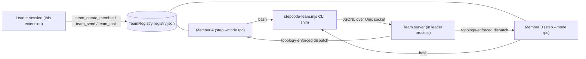

# Step-Code-Agent-Team

Agent team plugin for [Step Code](https://stepfun.com) (`step`): your current session becomes a **leader** that spawns resumable **member** agents, decomposes goals into a dependency-aware **task board**, dispatches work in parallel, and lets members message each other directly.

> **Reference:** This project references the **agent teams feature of DeepSeek Harness** — the leader/member model, the dependency-aware task board, and member-to-member messaging follow its design. It is an independent implementation for Step Code and is not affiliated with DeepSeek.

[简体中文说明 →](./README_ZH.md)

## How it works



- **Members are real `step` processes** with their own context window, model, and tool allowlist, spoken to over the RPC protocol. A member's context lives in its session file, so respawning it with the same session id resumes the conversation.
- **The task board is a DAG**: a task is `ready` when every task in its `blockedBy` is `done`; cycles are rejected.
- **Messaging**: members reach teammates through the `stepcode-team` CLI shim, which talks to a Unix socket served by the leader process. Direct messaging is gated by the declared topology (see below); the default star routes everything through the leader.
- **Guardrails**: max 8 members, max 5 concurrent dispatches (queue-before-start), 180s per-dispatch timeout, cumulative-spend warning (`STEPCODE_TEAM_COST_WARN`, default $1), idle members reaped after 30 min (sessions stay resumable), all children killed on leader shutdown.

## Requirements

- The `step` CLI on your PATH.
- Node (for the `stepcode-team` shim, invoked as `node bin/stepcode-team.mjs`).
- No third-party npm dependencies.

## Install

```bash
# from a local checkout (adds the package to your step settings)
step install /path/to/Step-Code-Agent-Team

# dev loop: load the extension directly, no install
step -e ./extensions/index.ts
```

Then start a session and ask: *"Use the agent team to review this repo in parallel."* — or run `/agent-team` first; the plugin stays dormant until then.

## Activation (default off)

The plugin is **inactive when a session starts**: the team tools are hidden from
the model, and no server, timer, or member process exists. It activates when:

1. You invoke the **`/agent-team`** command (activates and shows the team board), or
2. Your prompt explicitly mentions the plugin (keywords like "agent team" /
   "智能体团队", configurable).

Once activated it stays on for the session. See
[docs/CONFIGURATION.md](docs/CONFIGURATION.md) to disable activation entirely or
tune the keywords.

## Tools

| Tool | Purpose |
|---|---|
| `team_create_member` | Create/resume a member (`name`, optional `role` preset, `model`, `thinking`, `tools`, `systemPrompt`) |
| `team_send` | Message a member and wait for the full reply; optional `taskId` (runs it as a task) or `mode: "oneshot"` (stateless) |
| `team_task` | Task board: `create` / `start` / `complete` / `fail` / `list` |
| `team_status` | Members, task board, cumulative spend |
| `team_disband` | Stop one member or the whole team (sessions persist) |
| `team_set_topology` | Declare the member messaging topology (`star`/`pipeline`/`mesh`/`ring`/`custom`) before dispatching work |
| `/agent-team` | Command: activate the plugin and show the team board |

## Member communication topology

Direct member-to-member messaging is **denied unless the topology allows it**. The leader designs the topology that fits the task with `team_set_topology` after creating members and before dispatching work; the default is a star, where everything routes through the leader.

| Shape | Edges | Fits |
|---|---|---|
| `star` (default) | none | Independent parallel strands that the leader merges |
| `pipeline` | m1→m2→…→mn (creation order) | Sequential refinement (scout → planner → worker → reviewer) |
| `mesh` | all ordered pairs | Peers cross-checking each other |
| `ring` | mi→mi+1 (wraps around) | Round-robin review |
| `custom` | explicit `{from, to}` list | Precise control |

Enforcement lives in the team server: every message carries its sender (injected at spawn time) and is checked against the declared edges; violations are rejected with the sender's allowed neighbors, which members can query with `stepcode-team status`. Set `topology.requireDeclaration: true` in the config to block all dispatches until the topology is explicitly declared — the literal "design before work" workflow. Full reference: [docs/CONFIGURATION.md](docs/CONFIGURATION.md).

## Bundled role presets (`agents/`)

| Preset | Tools | Use |
|---|---|---|
| `scout` | read-only | Codebase exploration, structured findings |
| `planner` | read-only | Implementation plans |
| `worker` | full | Executes plans, runs checks |
| `reviewer` | read-only | Adversarial review (correctness / style / security) |

Also included: `prompts/team-review.md` (parallel multi-reviewer chain) and
`skills/team-orchestration/SKILL.md` (when and how to form a team).

## Development sandbox

All development happens in `sandbox/` (gitignored), fully isolated from your real
`~/.stepcode` config, sessions, and projects:

```bash
./sandbox/run.sh     # launches step with STEP_CODING_AGENT_DIR pointed at sandbox/agent
bash sandbox/probe.sh  # zero-token protocol probe (expects "PROBE OK")
```

`run.sh` sets `STEP_CODING_AGENT_DIR`, `STEP_CODING_AGENT_SESSION_DIR`, and
`STEP_CODING_AGENT_PLAN_DIR` to `sandbox/agent/...`, and runs `step` in
`sandbox/project/` (a throwaway workspace). Export `STEP_API_KEY` in your shell
before runs that touch a model — keys are never written to disk.

## Project layout

```
extensions/    index.ts (wiring) · config.ts · activation.ts · rpc-client.ts ·
               members.ts · tasks.ts · registry.ts · team-server.ts ·
               presets.ts · tools.ts · render.ts
bin/           stepcode-team.mjs (member-side CLI shim)
agents/        role presets (scout · planner · worker · reviewer)
prompts/       team-review.md
skills/        team-orchestration/SKILL.md
docs/          CONFIGURATION.md (config reference)
sandbox/       isolated dev environment (gitignored)
```

## Configuration

All behavior lives in one JSON file, `<agentDir>/stepcode-agent-team.json`
(the sandbox points `agentDir` at `sandbox/agent`):

```jsonc
{
  "activation": { "enabled": true, "keywords": ["agent team", "智能体团队"], "notifyOnActivate": true },
  "models": { "available": ["step-5-preview"], "autonomousSelection": false, "autonomousThinking": false },
  "members": { "max": 8, "defaultRole": "worker", "defaultTools": null, "maxRecursionDepth": 1 },
  "dispatch": { "maxConcurrent": 5, "timeoutMs": 180000, "handshakeTimeoutMs": 15000, "retries": 1 },
  "oneshot": { "timeoutMs": 180000 },
  "cost": { "warnThreshold": 1 },
  "idle": { "reapAfterMs": 1800000, "reapIntervalMs": 300000 },
  "storage": { "dir": null },
  "debug": false
}
```

Key points: with `autonomousSelection` off (default) every member runs on the
conversation's current model; with `autonomousThinking` off (default) members
default to `high` thinking. `members.maxRecursionDepth` (default 1) bounds the
team tree — members cannot spawn sub-teams until you raise it; and
`dispatch.maxConcurrent` (default 5) caps simultaneously running members:
dispatches beyond the limit queue, and a member process is not started until a
slot frees. Full reference:
[docs/CONFIGURATION.md](docs/CONFIGURATION.md).

Environment overrides: `STEPCODE_TEAM_DEBUG=1` (≡ `debug: true`),
`STEPCODE_TEAM_COST_WARN=<usd>` (≡ `cost.warnThreshold`).
`STEPCODE_TEAM_SOCK` is injected automatically on member processes.

## Development

Zero-token smoke probes exercise the protocol layer without any model calls
(spawn, handshake, registry, task graph, socket round-trip, presets):

```bash
bash sandbox/probe.sh   # RPC handshake probe → expects "PROBE OK"

# member lifecycle / task board / messaging probes (print [smoke] logs to stderr):
printf '{"id":"1","type":"get_state"}\n' \
  | STEP_CODING_AGENT_DIR="$PWD/sandbox/agent" \
    STEP_CODING_AGENT_SESSION_DIR="$PWD/sandbox/agent/sessions" \
    step -e "$PWD/extensions/index.ts" -e "$PWD/sandbox/smoke-phase1.ts" \
    --mode rpc --session-id smoke --session-dir "$PWD/sandbox/agent/sessions" 2>&1 \
  | grep '\[smoke\]'
```

(swap `smoke-phase1.ts` for `smoke-phase2.ts` / `smoke-phase3.ts` for the task
board and messaging probes). Everything runs inside `sandbox/`, isolated from
your real `~/.stepcode` state.

> **Headless runs:** `step -p` blocks tools that spawn processes or modify the
> workspace unless a permission preset is configured. For unattended runs, add
> `--approval-mode auto` (or `--non-interactive-approval allow`).

## Documentation

| Document | Contents |
|---|---|
| [docs/ARCHITECTURE.md](docs/ARCHITECTURE.md) | Components, data flow, storage layout, guardrail map |
| [docs/PROTOCOL.md](docs/PROTOCOL.md) | Member RPC protocol, socket protocol, registry schema, tool contracts |
| [docs/CONFIGURATION.md](docs/CONFIGURATION.md) | Config reference |
| [docs/TESTING.md](docs/TESTING.md) | How to run the four test layers |

## Known limitations

- **Project-level config is not wired yet**: `<cwd>/.stepcode/stepcode-agent-team.json` is
  reserved in the loader but not applied (project trust information is only available inside
  event handlers, which would break the "config before tool registration" ordering).
- **LLM behavior cannot be fully controlled**: members may abandon tools to investigate their
  environment; coordination prompts are hardened but this cannot be eliminated.
- **TUI rendering is not manually verified**: `render.ts` only runs in the interactive TUI,
  which headless probes do not cover.
- **Sandbox probes are gitignored**: `sandbox/smoke-phase*.ts` and `sandbox/TEST-PLAN.md` are
  not in the repo; a fresh environment must rebuild the config fixtures per the test-plan matrix.
- **Depth ≥ 3 is not live-tested with a real LLM chain** (process-level self-bootstrap is
  verified; the depth bound constrains deeper trees).

## License

MIT — see [LICENSE](LICENSE).

## Platform constraints

This plugin targets **Step Code only** and uses exclusively standard extension
APIs: `pi.registerTool` / `pi.registerCommand` / `ctx.ui.notify` / tool
`renderCall` + `renderResult` (pi-tui `Text`) / `onUpdate` streaming.

It does **not** depend on the DeepSeek Harness "better sidebar" plugin — or any
other DSH-only plugin — because no such plugin exists in Step Code. If a
sidebar-like UI is ever added, it must be built on Step Code native APIs, or
sit behind an optional interface that degrades to a no-op when the dependency
is absent, so the core team functionality always runs.

## Status

Phases 0–5 of the development plan are implemented and validated:

- **Protocol layer** (zero-token smoke probes, `sandbox/smoke-phase*.ts`):
  spawn, handshake, registry persistence, task graph, socket round-trip,
  preset loading.
- **Model-touching paths** (validated in the sandbox with a test key): member
  replies, context memory within a live member, resume after respawn via
  session id, member-to-member messaging through the shim, and end-to-end
  leader tool-calling (`team_create_member` → `team_send` → verbatim reply).
