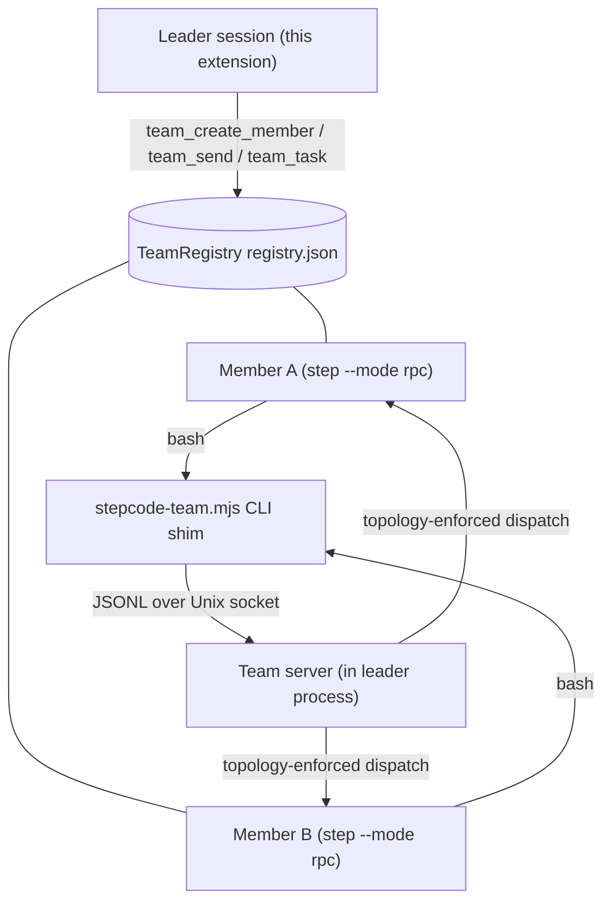
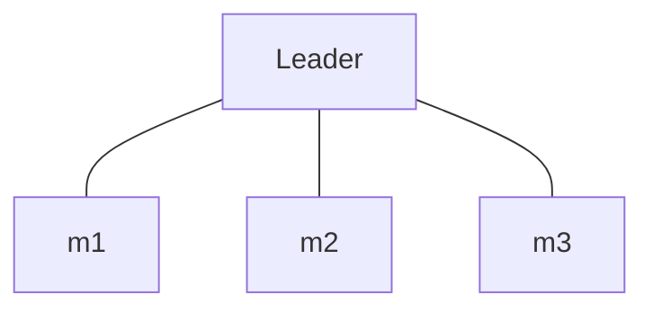
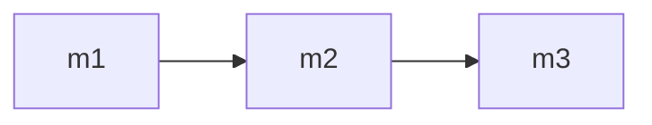
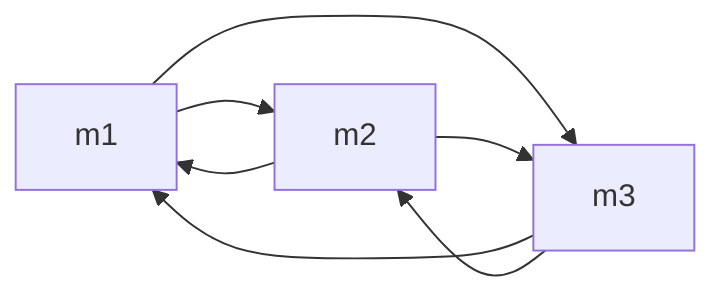
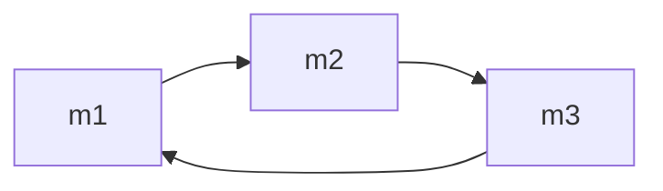
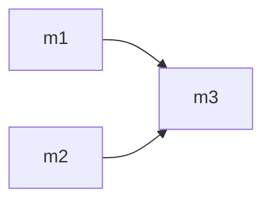

# Step-Code-Agent-Team

[简体中文说明 →](./README_ZH.md)

Agent team plugin for [Step Code](https://github.com/stepfun-ai/Step-Code) (`step`): your current session becomes a **leader** that spawns resumable **member** agents, decomposes goals into a dependency-aware **task board**, dispatches work in parallel, and lets members message each other directly.

> **Reference:** This project references the **agent teams feature of DeepSeek Harness** — the leader/member model, the dependency-aware task board, and member-to-member messaging follow its design. It is an independent implementation for Step Code and is not affiliated with DeepSeek.

> **⚠️ Cost warning:** every team member is a full agent process with its own
> context window, running on the conversation's current model (default thinking:
> `high`). N members working in parallel cost roughly N× a single conversation
> turn, and long member runs accumulate quickly. The plugin tracks cumulative
> team spend and warns at `cost.warnThreshold` (default $1, 0 disables) — watch
> `team_status`, and disband idle members when the work is done.

## How it works



- **Members are real `step` processes** with their own context window, model, and tool allowlist, spoken to over the RPC protocol. A member's context lives in its session file, so respawning it with the same session id resumes the conversation.
- **The task board is a DAG**: a task is `ready` when every task in its `blockedBy` is `done`; cycles are rejected.
- **Messaging**: members reach teammates through the `stepcode-team` CLI shim, which talks to a Unix socket served by the leader process. Direct messaging is gated by the declared topology (see below); the default star routes everything through the leader. The shim runs through a shell, so a member needs `bash` in its tool allowlist to message teammates — the read-only presets (`scout`/`planner`/`reviewer`) cannot, and the leader relays for them.
- **Guardrails**: max 8 live members (disbanded or reaped members no longer count against the limit), max 5 concurrent dispatches (queue-before-start), 180s per-dispatch timeout, cumulative-spend warning (`STEPCODE_TEAM_COST_WARN`, default $1), idle members reaped after 30 min (sessions stay resumable), all children killed on leader shutdown.

## Requirements

- The `step` CLI on your PATH.
- Node (for the `stepcode-team` shim, invoked as `node bin/stepcode-team.mjs`).
- No third-party npm dependencies.

## Install

```bash
# Dev loop: load the extension straight from a checkout, no install
step -e ./extensions/index.ts

# Try the full package (extension + skill + prompt) without installing
step -e /absolute/path/to/Step-Code-Agent-Team

# Install from a checkout — records the path in your step settings
step install /absolute/path/to/Step-Code-Agent-Team
step remove /absolute/path/to/Step-Code-Agent-Team  # uninstall (same path)
```

Local-path installs are **reference-only**: step records the path in your step
configuration and loads the package's declared resources (the `pi` manifest
in `package.json`: `extensions/`, `skills/`, `prompts/`) from it — nothing is
copied, so `local/` (credentials) and `sandbox/` (dev state) are never involved.
Use an absolute path (relative paths resolve against the step config file's
directory, not your shell's cwd), and note the entry breaks if the checkout
moves. Add `-l` to install project-locally instead (the project's `.stepcode/`
config, shared with your team, auto-installed once the project is trusted).

From git or npm — no packaging step needed, it is a standard step package:

```bash
step install git:github.com/CTCingithub/Step-Code-Agent-Team        # tracks the default branch
step install git:github.com/CTCingithub/Step-Code-Agent-Team@v0.1.0 # or pin a tag
step install npm:step-code-agent-team                               # once published to npm
```

Then start a session and ask: *"Use the agent team to review this repo in parallel."* — or run `/agent-team` first; the plugin stays dormant until then.

## Activation (default off)

The plugin is **inactive when a session starts**: the team tools are hidden from
the model, and no server, timer, or member process exists. It activates when:

1. You invoke the **`/agent-team`** command (activates and shows the team board), or
2. Your prompt explicitly mentions the plugin (keywords like "agent team" /
   "智能体团队", configurable).

Once activated it stays on for the session. See
[docs/CONFIGURATION.md](docs/CONFIGURATION.md) to disable activation entirely or
tune the keywords.

## Tools

| Tool | Purpose |
|---|---|
| `team_create_member` | Create/resume a member (`name`, optional `role` preset, `model`, `thinking`, `tools`, `systemPrompt`) |
| `team_send` | Message a member and wait for the full reply; optional `taskId` (runs it as a task) or `mode: "oneshot"` (stateless) |
| `team_task` | Task board: `create` / `start` / `complete` / `fail` / `list` |
| `team_status` | Members, task board, cumulative spend |
| `team_disband` | Stop one member or the whole team (sessions persist) |
| `team_set_topology` | Declare the member messaging topology (`star`/`pipeline`/`mesh`/`ring`/`custom`) before dispatching work |
| `/agent-team` | Command: activate the plugin and show the team board; text after the command is forwarded to the agent |

## Member communication topology

Direct member-to-member messaging is **denied unless the topology allows it**. The leader designs the topology that fits the task with `team_set_topology` after creating members and before dispatching work; the default is a star, where everything routes through the leader.

| Shape | Edges | Fits |
|---|---|---|
| `star` (default) | none | Independent parallel strands that the leader merges |
| `pipeline` | m1→m2→…→mn (creation order) | Sequential refinement (scout → planner → worker → reviewer) |
| `mesh` | all ordered pairs | Peers cross-checking each other |
| `ring` | mi→mi+1 (wraps around) | Round-robin review; chain length bounded by `topology.maxLoopCount` (default 2, 0 = unlimited) |
| `custom` | explicit `{from, to}` list | Precise control |

**`star` (default)** — no member↔member edges; the leader relays everything:



**`pipeline`** — ordered handoffs in member creation order:



**`mesh`** — every member may message every other member:



**`ring`** — each member may message the next (wraps around); the message chain is bounded by `topology.maxLoopCount` (default 2, 0 = unlimited):



**`custom`** — explicit `{from, to}` edges:



Enforcement lives in the team server: every message carries its sender (injected at spawn time) and is checked against the declared edges; violations are rejected with the sender's allowed neighbors, which members can query with `stepcode-team status`. In a ring, each forwarded message extends the sender's chain by one hop; a hop that would exceed `topology.maxLoopCount` (default 2, 0 = unlimited) is rejected and the sender is told to report to the leader instead — which also prevents ring-circulation deadlocks. Set `topology.requireDeclaration: true` in the config to block all dispatches until the topology is explicitly declared — the literal "design before work" workflow. Full reference: [docs/CONFIGURATION.md](docs/CONFIGURATION.md).

## Bundled role presets (`agents/`)

| Preset | Tools | Use |
|---|---|---|
| `scout` | read-only | Codebase exploration, structured findings |
| `planner` | read-only | Implementation plans |
| `worker` | full | Executes plans, runs checks |
| `reviewer` | read-only | Adversarial review (correctness / style / security) |

Also included: `prompts/team-review.md` (parallel multi-reviewer chain) and
`skills/team-orchestration/SKILL.md` (when and how to form a team).

## Development sandbox

The sandbox ships with the repo and is fully isolated from your real
`~/.stepcode` config, sessions, and projects (its runtime state — agent dir,
sessions, team registries, `auth.json` — is gitignored). `sandbox/step` is a
git submodule pinning the Step Code revision this sandbox tracks; clone with
`--recurse-submodules` (or run `git submodule update --init sandbox/step`),
and see `sandbox/README.md` for the update/build workflow:

```bash
./sandbox/run.sh     # launches step with STEP_CODING_AGENT_DIR pointed at sandbox/agent
bash sandbox/probe.sh  # zero-token protocol probe (expects "PROBE OK")
bash sandbox/restore-project.sh  # reset the demo project (sandbox/project) to its seeded-bug state
```

`run.sh` sets `STEP_CODING_AGENT_DIR`, `STEP_CODING_AGENT_SESSION_DIR`, and
`STEP_CODING_AGENT_PLAN_DIR` to `sandbox/agent/...`, and runs `step` in
`sandbox/project/` (a throwaway demo workspace). Export your own `STEP_API_KEY`
in your shell before runs that touch a model — keys are never written to disk.
The LLM-layer probes (`sandbox/smoke-phase4/10/11/12.ts`) are included too; see
[docs/TESTING.md](docs/TESTING.md) and `sandbox/README.md`.

## Project layout

```
extensions/    index.ts (wiring) · config.ts · activation.ts · rpc-client.ts ·
               members.ts · tasks.ts · registry.ts · team-server.ts ·
               topology.ts · presets.ts · tools.ts · render.ts
bin/           stepcode-team.mjs (member-side CLI shim)
agents/        role presets (scout · planner · worker · reviewer)
prompts/       team-review.md
skills/        team-orchestration/SKILL.md
docs/          ARCHITECTURE · PROTOCOL · CONFIGURATION · TESTING ·
               TUI-VERIFICATION · MANUAL-TESTING references
test/          smoke/ zero-token probes + run-smoke.sh (npm run smoke)
sandbox/       isolated dev environment (ships with the repo; runtime state gitignored)
               └── step/  Step Code source submodule (pinned revision)
```

## Configuration

All behavior lives in the plugin's `stepcodeAgentTeam` config section. Step Code
first kept settings in `settings.json` and later moved them to the unified
`config.toml` (`agent/settings.json` is retired there); both locations are
honored, and the unified config is the current convention. Precedence:
defaults < legacy files < settings.json sections < config.toml tables <
environment overrides.

| Tier | Path | Notes |
|---|---|---|
| Global | `[stepcodeAgentTeam]` table in `<stepRoot>/config.toml` (beside the agent dir, default `~/.stepcode`) | Legacy fallback: `stepcodeAgentTeam` section of `<agentDir>/settings.json` |
| Project | `[stepcodeAgentTeam]` table in `<cwd>/.stepcode/config.toml` | Loaded only when the project is trusted; legacy fallback: `<cwd>/.stepcode/settings.json` |
| Environment | `STEPCODE_TEAM_DEBUG` · `STEPCODE_TEAM_COST_WARN` · `STEPCODE_TEAM_MAXDEPTH` | One-off overrides; highest precedence |

**How to apply changes:** add a `[stepcodeAgentTeam]` table to `config.toml`
(unknown keys are ignored; invalid values fall back to defaults with a debug
warning; the plugin only reads its section and never writes the file) and start
a new session — config is read once at load. `/reload` re-reads it but also
returns the plugin to its default-off state. Environment overrides apply to a
single run. Legacy dedicated files (`<agentDir>/stepcode-agent-team.json`,
`<cwd>/.stepcode/stepcode-agent-team.json`) and the `settings.json` sections are
still honored as a fallback. Full reference:
[docs/CONFIGURATION.md](docs/CONFIGURATION.md).

```toml
# Global: <stepRoot>/config.toml · Project: <cwd>/.stepcode/config.toml
[stepcodeAgentTeam.activation]
enabled = true
keywords = ["agent team", "智能体团队"]
notifyOnActivate = true

[stepcodeAgentTeam.models]
available = ["step-5-preview"]
autonomousSelection = false
autonomousThinking = false

[stepcodeAgentTeam.members]
max = 8
defaultRole = "worker"
# defaultTools omitted (TOML has no null) = use the preset or all tools
maxRecursionDepth = 1

[stepcodeAgentTeam.dispatch]
maxConcurrent = 5
timeoutMs = 180000
handshakeTimeoutMs = 15000
retries = 1

[stepcodeAgentTeam.oneshot]
timeoutMs = 180000

[stepcodeAgentTeam.cost]
warnThreshold = 1

[stepcodeAgentTeam.idle]
reapAfterMs = 1800000
reapIntervalMs = 300000

[stepcodeAgentTeam.storage]
# dir omitted = <agentDir>/teams

[stepcodeAgentTeam.topology]
default = "star"
requireDeclaration = false
maxLoopCount = 2

[stepcodeAgentTeam]
debug = false
```

### Options at a glance

| Section | Key options (default) | What it controls |
|---|---|---|
| `activation` | `enabled` (true) · `keywords` · `notifyOnActivate` (true) | Default-off gate: the `/agent-team` command or a keyword mention activates the plugin |
| `models` | `available` (`["step-5-preview"]`) · `autonomousSelection` (false) · `autonomousThinking` (false) | Member model pool; with the autonomous switches off, members use the conversation model and `high` thinking |
| `members` | `max` (8) · `defaultRole` (`worker`) · `defaultTools` (null) · `maxRecursionDepth` (1) | Live-member cap (dead members don't count), default role and tool allowlist, team-tree depth bound |
| `dispatch` | `maxConcurrent` (5) · `timeoutMs` (180000) · `handshakeTimeoutMs` (15000) · `retries` (1) | Concurrency gate (queue-before-start), per-dispatch timeouts, retry count |
| `oneshot` | `timeoutMs` (180000) | Stateless `mode: "oneshot"` dispatch timeout |
| `cost` | `warnThreshold` (1) | Cumulative team spend warning (0 disables) |
| `idle` | `reapAfterMs` (1800000) · `reapIntervalMs` (300000) | Idle member reaping (sessions stay resumable) |
| `storage` | `dir` (null) | Team data root; null = `<agentDir>/teams` |
| `topology` | `default` (`star`) · `requireDeclaration` (false) · `maxLoopCount` (2) | Default shape, design-before-work gate, ring message-chain bound (0 = unlimited) |
| `debug` | `false` | Diagnostic logging |

Key points: with `autonomousSelection` off (default) every member runs on the
conversation's current model; with `autonomousThinking` off (default) members
default to `high` thinking. `members.maxRecursionDepth` (default 1) bounds the
team tree — members cannot spawn sub-teams until you raise it; and
`dispatch.maxConcurrent` (default 5) caps simultaneously running members:
dispatches beyond the limit queue, and a member process is not started until a
slot frees. Full reference:
[docs/CONFIGURATION.md](docs/CONFIGURATION.md).

Environment overrides: `STEPCODE_TEAM_DEBUG=1` (≡ `debug: true`),
`STEPCODE_TEAM_COST_WARN=<usd>` (≡ `cost.warnThreshold`),
`STEPCODE_TEAM_MAXDEPTH=<n>` (≡ `members.maxRecursionDepth`, 1–4; the leader
injects the effective value into member processes).
`STEPCODE_TEAM_SOCK` is injected automatically on member processes.

## Development

Zero-token smoke probes exercise the protocol layer without any model calls
(spawn, handshake, registry, task graph, socket round-trip, presets):

```bash
bash sandbox/probe.sh   # RPC handshake probe → expects "PROBE OK"

npm run smoke           # full zero-token suite (test/smoke/phase1,2,3,5,6,7,8,9,13,14,15,16,17)
                        # hermetic: throwaway agent dir; phase 5 is skipped
                        # unless STEP_API_KEY is set (it makes one real call)
```

The suite ships in `test/smoke/` with a hermetic runner (`test/run-smoke.sh`,
temporary agent dir via mktemp). LLM-path probes (`sandbox/smoke-phase4/10/11/12.ts`)
need a test key; see [docs/TESTING.md](docs/TESTING.md) and `sandbox/README.md`.

> **Headless runs:** `step -p` blocks tools that spawn processes or modify the
> workspace unless a permission preset is configured. For unattended runs, add
> `--approval-mode auto` (or `--non-interactive-approval allow`).

## Documentation

| Document | Contents |
|---|---|
| [docs/ARCHITECTURE.md](docs/ARCHITECTURE.md) | Components, data flow, storage layout, guardrail map |
| [docs/PROTOCOL.md](docs/PROTOCOL.md) | Member RPC protocol, socket protocol, registry schema, tool contracts |
| [docs/CONFIGURATION.md](docs/CONFIGURATION.md) | Config reference |
| [docs/TESTING.md](docs/TESTING.md) | How to run the four test layers |

## Known limitations

- **Project-level config has two timing compromises**: tool description strings built at
  registration (e.g. the model list) and this process's depth gate are not refreshed by a
  project-level override; the effective depth bound is propagated to sub-leaders via
  `STEPCODE_TEAM_MAXDEPTH`, and description changes take effect next session.
- **LLM behavior cannot be fully controlled**: members may abandon tools to investigate their
  environment; coordination prompts are hardened but this cannot be eliminated.
- **TUI rendering is not manually verified**: `render.ts` only runs in the interactive TUI,
  which headless probes do not cover.
- **LLM-path probes need your own key**: `sandbox/smoke-phase4/10/11/12.ts` and the `cfg-*`
  fixtures now ship with the repo (sandbox runtime state stays gitignored), but they make real
  model calls — export your own `STEP_API_KEY` first. The zero-token suite (`npm run smoke`)
  needs no key.
- **Depth ≥ 3 is not live-tested with a real LLM chain** (process-level self-bootstrap is
  verified; the depth bound constrains deeper trees).

## License

MIT — see [LICENSE](LICENSE).

## Platform constraints

This plugin targets **Step Code only** and uses exclusively standard extension
APIs: `pi.registerTool` / `pi.registerCommand` / `ctx.ui.notify` / tool
`renderCall` + `renderResult` (pi-tui `Text`) / `onUpdate` streaming.

It does **not** depend on the DeepSeek Harness "better sidebar" plugin — or any
other DSH-only plugin — because no such plugin exists in Step Code. If a
sidebar-like UI is ever added, it must be built on Step Code native APIs, or
sit behind an optional interface that degrades to a no-op when the dependency
is absent, so the core team functionality always runs.

## Status

Phases 0–5 of the development plan are implemented and validated:

- **Protocol layer** (zero-token smoke probes, `test/smoke/phase*.ts`):
  spawn, handshake, registry persistence, task graph, socket round-trip,
  preset loading.
- **Model-touching paths** (validated in the sandbox with a test key): member
  replies, context memory within a live member, resume after respawn via
  session id, member-to-member messaging through the shim, and end-to-end
  leader tool-calling (`team_create_member` → `team_send` → verbatim reply).
