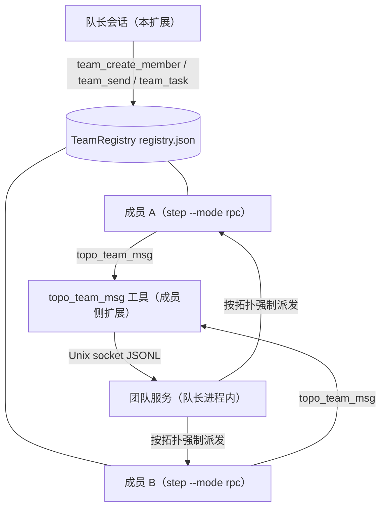
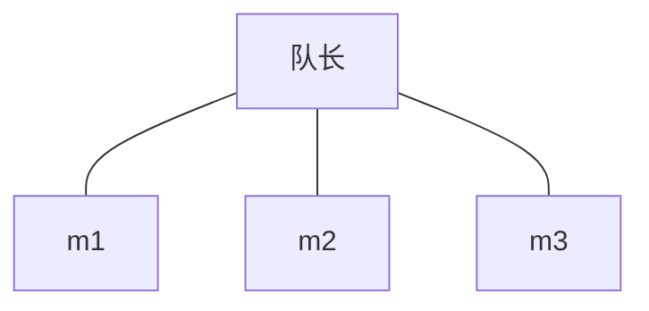
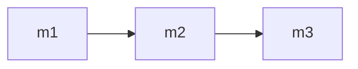
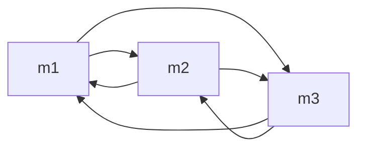
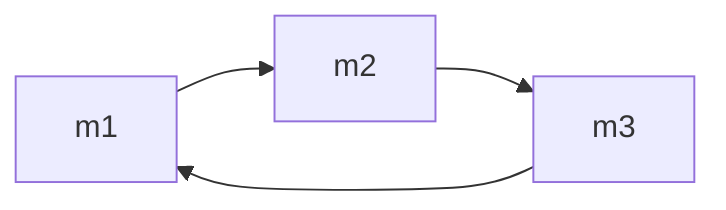
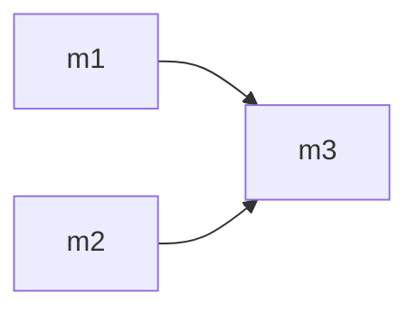

# Step-Code-Agent-Team

[English →](./README.md)

[Step Code](https://github.com/stepfun-ai/Step-Code)（`step`）的拓扑智能体团队插件：当前会话成为**队长**，按需创建可续聊的**成员** Agent，把目标拆解为带依赖的**任务板**，并行调度成员执行，并支持成员间直达消息。

> **参考说明：** 本项目**参考了 DeepSeek Harness 的智能体团队（agent teams）功能**——队长/成员模型、带依赖的任务板、成员间消息均沿袭其设计。本插件是面向 Step Code 的独立实现，与 DeepSeek 无隶属关系。

> **⚠️ 消耗警告：** 每个团队成员都是独立的完整 agent 进程，拥有自己的上下文窗口，
> 默认使用对话当前模型（各角色预设 effort：`scout`=low、`planner`/`worker`=medium、`reviewer`=high；无预设时 `high`——`models.autonomousEffort` 开启时由队长逐成员选择，预设 effort 一律不生效，详见下方角色表）。N 个成员并行干活的成本约为单轮对话的 N 倍，
> 长任务累积很快。插件会统计团队累计花费，并在 `cost.warnThreshold`
> （默认 $1，0 禁用）时告警——请留意 `team_status`，完工后及时 `team_disband`
> 回收空闲成员。

## 工作原理



- **成员是真实的 `step` 进程**：独立上下文窗口、可配模型与工具白名单，通过 RPC 协议驱动。成员上下文持久化在 session 文件中，用同一 session-id 重启即可续聊。
- **任务板是 DAG**：`blockedBy` 全部完成的任务才 `ready`；成环的依赖在创建时即被拒绝。
- **成员间消息**：成员通过内置 `topo_team_msg` 工具连接队长进程内的 Unix socket 与队友通信；直达消息受**拓扑**约束（见下），默认星型下全部经由队长中转。该工具不需要 shell——只读预设（`scout`/`planner`/`reviewer`）保持原状，其拓扑边始终可用。`stepcode-team` CLI shim 保留作手动/外部路径。
- **护栏**（以下为默认值——每个数字都可在 step 的 `config.toml` 的 `[stepcodeAgentTeam]` 表中配置，见 [CONFIGURATION_CN.md](docs/CONFIGURATION_CN.md)）：最多 8 个**存活**成员（解散/回收的成员不再占名额）；最多 5 个并发调度（超出则排队，轮到才启动）；单次调度 600s 超时（覆盖成员整回合，含嵌套中继）；累计花费超 `STEPCODE_TEAM_COST_WARN`（默认 $1）时告警；空闲 30 分钟的成员被回收（session 保留可恢复）；任务板与单任务输出上限（999 个任务 / 50 KiB）；队长退出时全部子进程被清理。

## 环境要求

- PATH 中可用的 `step` CLI。
- Node（`step` 运行时本身；可选的 `stepcode-team` shim 以 `node bin/stepcode-team.mjs` 方式调用）。
- 无第三方 npm 依赖。

## 安装

```bash
# 开发期：从检出副本直接加载扩展，无需安装
step -e ./extensions/index.ts

# 免安装试运行整个包（pi manifest 仅声明扩展——不再分发技能或提示词模板）
step -e /absolute/path/to/Step-Code-Agent-Team

# 从检出副本安装——仅把路径写进 step 设置
step install /absolute/path/to/Step-Code-Agent-Team
step remove /absolute/path/to/Step-Code-Agent-Team  # 卸载（同一路径）
```

本地路径安装是**引用式**的：step 只把路径记入你的 step 配置，并按包
`package.json` 中 `pi` manifest 声明的资源（仅 `extensions/`——插件不再分发
skill 或提示词模板资源；编排协议在激活时经请求本地注入，评审工作流是
`/topo review` 命令）从该路径加载——不发生任何拷贝，`local/`（凭证）与 `sandbox/`
（开发状态）不会被卷入。请使用**绝对路径**（相对路径相对 step 配置文件所在目
录解析，不是 shell 的 cwd）；移动或删除检出副本会使该设置失效。加 `-l` 改为
项目级安装（项目 `.stepcode/` 配置，可随团队共享，项目信任后自动安装）。

从 git 安装——无需任何打包步骤，它就是标准 step 包：

```bash
step install git:github.com/CTCingithub/Step-Code-Agent-Team@latest         # 稳定发布版（推荐；当前为 v0.3.0）
step install git:github.com/CTCingithub/Step-Code-Agent-Team@v0.3.0           # 本版本，钉住
step install git:github.com/CTCingithub/Step-Code-Agent-Team@v0.3.0-preview   # 预览线（已被 v0.3.0 取代；latest 绝不因预览版移动）
```

**排障——启动时报 "Tool … conflicts with …"**：step 会加载 `packages` 里的每一项，而本插件在同一份配置里只能安装一份。本地路径安装（`step install /path/to/checkout`）与 git 安装（`git:github.com/…`）并存会加载两份 `extensions/index.ts`，六个团队工具名全部冲突、扩展加载失败，step 可能无法启动。修复：只保留一项——对另一项执行 `step remove`（用当初安装时相同的路径或 git 规格）。

**分发方式**：仅 git——本插件不发布到 npm。稳定线用
`step install git:github.com/CTCingithub/Step-Code-Agent-Team@latest`（或锁定版本 tag）；`latest` 只跟随正式版，预览版绝不移动它。

然后在会话里下达目标，例如："用智能体小队并行审查这个仓库"（或先运行 `/topo`——插件在此之前保持静默）。

## 激活机制（默认关闭）

插件在会话启动时**不激活**：团队工具对模型不可见，也不存在 socket、定时器或成员进程。两种触发方式：

1. **斜杠命令 `/topo`**：调用即激活，并展示团队板；
2. **自然语言**：prompt 文本命中激活关键词（清单见下，可配置）。

激活后在本次会话内保持。**`/topo off`** 可再次停用并重新隐藏团队工具——误激活后的出口（成员 session 仍可恢复）。**迁移说明：** `/agent-team` 别名已在 0.2.0 移除——`/topo` 是唯一命令。旧版激活关键词（"agent team" / "智能体团队" / "组队" 等裸词）会在加载时从生效清单中剥离，避免遮蔽未来官方的智能体团队功能；被剥离的词会在激活时提示一次。用户的配置文件不会被改写。

### `/topo` 命令

| 形式 | 功能 |
|---|---|
| `/topo` | 激活插件并展示团队板（成员、任务、花费）。`plan.enabled = true` 且 `plan.tier = "always ask"` 时，先弹档位选单 |
| `/topo <你的请求>` | 激活并把请求**逐字**转发给智能体——“使用团队”指令经 context 事件请求本地注入（不写入会话日志） |
| `/topo off` | 停用并重新隐藏团队工具——误激活后的出口（成员 session 仍可恢复） |
| `/topo <档位>` | 激活并直接应用团队策略：`economic`、`fast`、`balanced`、`performance`（跳过选单；见团队方案） |
| `/topo custom` | 激活并走自定义流程（参考规模 → 拓扑 → effort，并可附上你的需求文本） |
| `/topo review [目标]` | 激活并运行并行多评审员协议（三名 reviewer + 一名 worker 合并） |

headless/RPC 会话无法弹对话框：选单直接回退 `balanced` 档，确认框为隐式同意。`/topo` 后接档位名有参数补全。

### 激活关键词（0.2.0 默认清单）

仅插件专属关键词会激活插件。"智能体团队" / "agent team" / "组队" 等裸词已在 0.2.0 刻意移除，避免与未来官方智能体团队功能撞车：

```text
智能体小队 · 多智能体小队 · 组小队 · stepcode 小队 · topo team · topo-agent ·
stepcode topo · topology team · agent squad · stepcode-agent-team ·
step code agent team · team_create_member · team_send · team_task
```

（共 14 个；经 `activation.keywords` 调整——见
[docs/CONFIGURATION.md](docs/CONFIGURATION_CN.md)。）

### 防误触护栏（默认开启）

关键词激活经过三层护栏——斜杠命令是显式意图，**不经过**任何一层：

- **L1 启发式否决**（`activation.guardEnabled`）：读作否定句（"不用组小队"）、元讨论（"什么是智能体小队"）或代码引用（反引号、import、函数调用）的命中不激活；
- **L2 TUI 确认**（`activation.confirmBeforeActivate`）：交互 TUI 中关键词命中先弹确认框；
- **L3 headless/RPC 自动激活**（`activation.headlessAutoActivate`）：脚本化运行无人应答，直接激活。

三项默认均为 `true`。

## 团队方案（默认关闭）

可选的团队*策略*。`plan.enabled = true` 时，经 `/topo` 激活会弹选单——或直接应用固定的策略：

```toml
# ~/.stepcode/config.toml（或 <项目>/.stepcode/config.toml）
[stepcodeAgentTeam.plan]
enabled = false
tier = "always ask"   # always ask | economic | fast | balanced | performance
```

| 策略 | 说明 |
|---|---|
| 经济 Economic | 成本最低：少成员、低 effort，省去不必要的环节 |
| 快速 Fast | 耗时最短：立即并行开工 |
| 均衡 Balanced *（未选择时的回退）* | 在成本与质量间平衡，覆盖勘察、规划、执行、审查 |
| 性能 Performance | 质量最高、不计成本：多成员、高 effort 深度协作 |

档位是**策略提示词，而非固定阵容**：指令说明策略并给出非绑定示例（如"1 名 scout + 1 名 worker，effort 取 low/medium，拓扑用 star"），具体成员、角色、拓扑与 effort 由队长模型按任务实际需要决定。`/topo` 带请求文本时，模型先经一次性规划调用（带进度动画）为该请求起草**实际方案**，Accept / Cancel / Other 三选项选择框展示之——批准后以高于一般性策略的优先级注入；选 Other 可输入自由文本，随请求原样转发。选单第 5 项——**自定义需求**——走一段简短引导（团队规模 → 拓扑 → effort），自由文字需求随请求一并携带。`plan.tier` 钉档时上述选单与确认框一律不弹（两路激活直接应用该档——「别再问」）。

选单行为：选项按语言本地化（英文请求显示 Economic/Fast/Balanced/Performance）；30 秒超时回退 `balanced` 策略；headless/RPC 激活跳过选单直接应用。`plan.tier` 固定为某一策略时，每次激活（`/topo` 或关键词命中）都直接应用、不再询问；`/topo <档位名>` 仍可按次覆盖。

## 工具

| 工具 | 用途 |
|---|---|
| `team_create_member` | 创建/恢复成员（`name`，可选 `role` 预设、`model`、`effort`、`tools`、`systemPrompt`） |
| `team_send` | 给成员发消息并等待完整回复；可带 `taskId`（按任务执行）或 `mode: "oneshot"`（无状态） |
| `team_task` | 任务板：`create` / `start` / `complete` / `fail` / `list` |
| `team_status` | 成员、任务板、累计花费 |
| `team_disband` | 停止单个成员或全队（session 保留） |
| `team_set_topology` | 派活前声明成员通信拓扑（`star`/`pipeline`/`mesh`/`ring`/`custom`）；传 `members` 可将 pipeline/mesh/ring 限定为当前成员的子集 |
| `/topo` | 命令：激活插件并查看团队板。`/topo off` 停用并重新隐藏团队工具；`/topo <档位>`（economic/fast/balanced/performance/custom）应用团队策略（见「团队方案」）；`/topo review [目标]` 运行并行多评审员协议；命令后的文本**逐字转发**给 agent——「使用团队」指令经 context 事件 request-local 注入，不写入会话文件 |

## 成员通信拓扑

除非拓扑允许，成员之间的直达消息会被**拒绝**。队长在创建成员后、派活前，用 `team_set_topology` 按任务结构设计拓扑；默认为星型——全部经由队长中转。传 `members` 可将 pipeline/mesh/ring 限定为当前成员的子集（如在累积了成员的团队中只让 3 名成员成环）——作用域外的成员没有任何边。

> **只读角色与拓扑边：** 所有成员——包括只读预设（scout/planner/reviewer）与不含 `bash` 的自定义角色——均经内置 `topo_team_msg` 工具直达通信，拓扑边对所有角色可用。依赖关系请用任务板的 `blockedBy` 表达；`stepcode-team` CLI shim 保留作手动使用。

| 形状 | 边 | 适用 |
|---|---|---|
| `star`（默认） | 无 | 并行独立、由队长汇总 |
| `pipeline` | m1→m2→…→mn（按创建顺序） | 顺序精炼（scout → planner → worker → reviewer） |
| `mesh` | 全部有序对 | 同伴互查 |
| `ring` | mi→mi+1（末位回环） | 环形流水；链长受 `topology.maxLoopCount` 约束（默认 2，0 = 无上限） |
| `custom` | 显式 `{from, to}` 列表 | 精确控制 |

**`star`（默认）** — 无成员间直连边，全部经队长中转：



**`pipeline`** — 按成员创建顺序接力：



**`mesh`** — 两两互通（全部有序对）：



**`ring`** — 每成员可通知下一位（末位回环）；消息链长度受 `topology.maxLoopCount` 约束（默认 2，0 = 无上限）。该上限计的是**单次队长派发内嵌套中继的深度**：队长自己的派发从 0 起算，成员→成员的每次转发 +1。因此 3 成员环若作为**同一次派发内的嵌套中继**巡游，其闭环跳（r3→r1）在默认值下会被拒；但若队长**逐跳重新派发**，每一跳都从 0 起算，三跳全会成功。想观察上限被触发，须让中继连续嵌套；想环内闭环，则把最后一跳交给队长中转，或调高上限：



**`custom`** — 显式 `{from, to}` 边：



强制点在团队服务：每条消息携带发送方身份（spawn 时注入）并对照声明的边检查；越界会被拒绝并告知可用邻居（`topo_team_msg` 被拒时会列出；`stepcode-team status` 亦可查询）。环形拓扑下每转发一次消息链长 +1；下一跳会使链长超过 `topology.maxLoopCount`（默认 2，0 = 无上限）时该消息被拒绝，发送方改为把结论写入最终报告交回队长（leader 不是消息目标）——同时避免环形巡游死锁。配置 `topology.requireDeclaration: true` 后，未显式声明拓扑前禁止任何派活——字面落实“先设计再开工”。完整参考：[docs/CONFIGURATION.md](docs/CONFIGURATION_CN.md)。

## 角色预设（`agents/` + 自定义角色）

| 预设 | 工具 | 用途 |
|---|---|---|
| `scout` | 只读 | 代码勘察、结构化汇报 |
| `planner` | 只读 | 制定实施计划 |
| `worker` | 全量 | 执行计划、运行检查 |
| `reviewer` | 只读 | 对抗式审查（正确性 / 风格 / 安全） |

预设 effort 默认值：`scout`=low、`planner`=medium、`worker`=medium、
`reviewer`=high。解析顺序：`team_create_member` 显式 `effort` 参数 →
`[stepcodeAgentTeam.presets.effort]` 配置覆盖（仅内置角色名）→ 预设
frontmatter `effort` → `high`。`models.autonomousEffort = true` 时由队长
逐成员选择 effort，所有预设 effort 一律不生效。

你可以添加自己的角色——把相同 frontmatter 格式的 Markdown 文件放入
`<agentDir>/agents/` 或 `<project>/.stepcode/agents/`（项目需信任），按角色名
覆盖内置预设：见 [docs/ROLES.md](docs/ROLES_CN.md)。

并行多审查员工作流以 **`/topo review [目标]`** 命令提供，编排协议在激活时经
请求本地注入——不再分发任何 skill 或提示词模板资源。

## 开发沙箱

沙箱随仓库分发，与真实 `~/.stepcode` 配置、会话、项目完全隔离（其运行时状态——
agent 目录、sessions、团队注册表、`auth.json`——在 gitignore 内）。`sandbox/step`
是钉住本沙箱跟踪版本的 Step Code 源码 submodule；克隆请用
`--recurse-submodules`（或克隆后 `git submodule update --init sandbox/step`），
更新与构建流程见 `sandbox/README_CN.md`：

```bash
./sandbox/run.sh       # 以沙箱环境变量启动 step（cwd 为 sandbox/project）
bash sandbox/probe.sh  # 零 token 协议探针（期望输出 PROBE OK）
bash sandbox/restore-project.sh  # 还原测试小项目到初始状态（种子 bug 复位、data/ 清除）
```

`run.sh` 会将 `STEP_CODING_AGENT_DIR`、`STEP_CODING_AGENT_SESSION_DIR`、
`STEP_CODING_AGENT_PLAN_DIR` 指向 `sandbox/agent/...`。涉及模型调用的运行前，
请在当前 shell `export STEP_API_KEY=<你自己的 key>`——密钥绝不落盘。
LLM 层探针（`sandbox/smoke-phase4/10/11/12.ts`）同样随仓库分发，跑法见
[docs/TESTING.md](docs/TESTING_CN.md) 与 `sandbox/README_CN.md`。

## 项目结构

```
extensions/    index.ts（接线）· config.ts · activation.ts · rpc-client.ts ·
               members.ts · tasks.ts · registry.ts · team-server.ts ·
               topology.ts · presets.ts · plan.ts · forward.ts · tools.ts ·
               member-messaging.ts · render.ts
bin/           stepcode-team.mjs（成员侧 CLI shim；手动/外部路径）
agents/        角色预设（scout · planner · worker · reviewer）
docs/          ARCHITECTURE · PROTOCOL · CONFIGURATION · ROLES · TESTING ·
               MANUAL-TESTING 参考文档
test/          smoke/ 零 token 探针 + run-smoke.sh（npm run smoke）
sandbox/       隔离开发环境（随仓库分发；运行时状态在 gitignore）
               └── step/  Step Code 源码 submodule（钉住跟踪的版本）
```

## 配置

全部行为参数由 Step Code 统一配置中的 `stepcodeAgentTeam` 表控制——全局在
`<stepRoot>/config.toml`（位于 agentDir 旁边，默认 `~/.stepcode`），项目级在
`<cwd>/.stepcode/config.toml`（仅项目被信任时加载）。优先级：内置默认 < 全局 <
项目级 < 环境变量覆盖（`STEPCODE_TEAM_DEBUG` · `STEPCODE_TEAM_COST_WARN` ·
`STEPCODE_TEAM_MAXDEPTH`）。无需配置文件；插件首次激活时会向你的全局配置追加
一段注释默认值块以便发现可配置项。配置在每次会话加载时只读一次（`/reload` 会
重新读取，但插件也会随之回到默认关闭状态）。

```toml
# ~/.stepcode/config.toml（或 <项目>/.stepcode/config.toml）
[stepcodeAgentTeam.members]
max = 8
defaultRole = "worker"

[stepcodeAgentTeam.dispatch]
maxConcurrent = 5

[stepcodeAgentTeam.plan]
enabled = false
tier = "always ask"

[stepcodeAgentTeam.presets.effort]
scout = "low"
planner = "medium"
worker = "medium"
reviewer = "high"
```

完整参考（全部配置节、语义与拓扑形状）：[docs/CONFIGURATION_CN.md](docs/CONFIGURATION_CN.md)。
`STEPCODE_TEAM_SOCK` 由队长自动注入成员进程。

## 开发

零 token 冒烟探针覆盖协议层行为（spawn、握手、注册表、任务图、socket 往返、预设），不调用任何模型：

```bash
bash sandbox/probe.sh   # RPC 握手探针 → 期望输出 PROBE OK

npm run smoke           # 零 token 冒烟集（test/smoke/phase1,2,3,5,6,7,8,9,13,14,15,16,17,18,19,20,21,22,23,24）
                        # hermetic：一次性临时 agentDir；phase5 未设 STEP_API_KEY 时
                        # 显式 SKIP（它会发起一次真实调用）
```

冒烟集随仓库分发（`test/smoke/` + `test/run-smoke.sh`，临时 agentDir 经 mktemp 创建）。
LLM 路径探针（`sandbox/smoke-phase4/10/11/12.ts`）需你自己的 key，跑法见
[docs/TESTING.md](docs/TESTING_CN.md) 与 `sandbox/README_CN.md`。

发版在 `main` 上经 `scripts/release.sh <version>` 完成——前置检查（树干净、在
`main`、tag 未占用）→ 冒烟门 → 版本 bump → 附注 tag → 推送 → `latest` 移动
（仅正式版；预览版绝不移动）→ 从已推送 tag 做 hermetic 安装实测。`develop` →
`main` 合并不在脚本内：先手动合并，再在 `main` 上运行本脚本。

> **仅开发路径**：`test/` 与 `sandbox/` 仅供开发使用——不在打包产物内
> （`package.json` 的 "files" 只分发扩展、agents 与文档）。跑冒烟集或使用沙箱
> 请克隆仓库；`step install` 安装包只含扩展本身。

> **无界面运行**：`step -p` 默认拦截会派生进程或修改工作区的工具；无人值守运行需加 `--approval-mode auto`（或 `--non-interactive-approval allow`）。

### 分支约定

后续版本开发先创建 `develop` 分支：从 `main` 切出（`git checkout main && git checkout -b develop`），
该版本的开发提交都在 develop 上进行。功能稳定、冒烟全绿后合并回 `main`
（`git checkout main && git merge develop`）并在 main 上发版——`main` 始终代表已发布状态，
`develop` 是下一版本的进行曲工作分支。仅正式版移动 `latest` 分支；预览标签
（如 `v0.2.0-preview`）不移动 latest，latest 保持稳定线。

## 文档

| 文档 | 内容 |
|---|---|
| [docs/ARCHITECTURE.md](docs/ARCHITECTURE_CN.md) | 组件、数据流、存储布局、护栏位置 |
| [docs/PROTOCOL.md](docs/PROTOCOL_CN.md) | 成员 RPC 协议、socket 协议、registry schema、工具契约 |
| [docs/CONFIGURATION.md](docs/CONFIGURATION_CN.md) | 配置参考 |
| [docs/ROLES.md](docs/ROLES_CN.md) | 自定义角色：目录、frontmatter 格式、effort 规则 |
| [docs/TEST-PLAN.md](docs/TEST-PLAN_CN.md) | 沙箱测试计划与执行历史 |
| [docs/TESTING.md](docs/TESTING_CN.md) | 四层测试的运行方法 |

## 已知限制

- **项目级配置有两个时序妥协**：注册时固化的工具描述串（模型列表等）与本进程的深度门不随项目级配置刷新；生效深度上限经 `STEPCODE_TEAM_MAXDEPTH` 向子成员传播，描述变化下一会话生效。
- **LLM 行为不可完全控**：成员可能弃用工具转去排查环境；协调提示已加固，无法根除。
- **TUI 渲染未实测**：`render.ts` 只在交互 TUI 生效，headless 探针覆盖不到。
- **LLM 层探针需自带 key**：`sandbox/smoke-phase4/10/11/12.ts` 与 `cfg-*` fixture 已随仓库分发（沙箱运行时状态仍在 gitignore），但会发起真实模型调用——跑前 export 你自己的 `STEP_API_KEY`。零 token 冒烟集（`npm run smoke`）无需 key。
- **depth≥3 未做真实 LLM 链测试**（进程级已验证，构造上受深度上限约束）。

## 许可证

MIT — 见 [LICENSE](LICENSE)。

## 平台约束

本插件仅面向 **Step Code**，只使用标准扩展 API：`pi.registerTool` /
`pi.registerCommand` / `ctx.ui.notify` / 工具的 `renderCall` + `renderResult`
（pi-tui `Text`）/ `onUpdate` 流式回调。

它**不依赖** DeepSeek Harness 的 "better sidebar" 插件——也不依赖任何 DSH
专属插件——因为 Step Code 中不存在这些插件。未来如需类似侧边栏的界面，必须基于
Step Code 原生 API 实现，或置于可选接口之后：依赖缺失时自动退化为空操作，
核心团队功能不受影响。

## 状态与验证

0.3.0 功能集（已打 tag `v0.3.0`——`@latest` 随之移动；此前的 `v0.3.0-preview` tag 仍指向同一份代码，仅安装行不同）：

- **命令与激活**：`/topo`（含方案档位、`/topo review [目标]`、`/topo off`）；插件专属激活关键词 + 旧词强制迁移；三层防误触护栏。
- **团队方案**（默认关）：经济 / 快速 / 均衡 / 性能四档策略提示词 + 自定义引导流程；带请求时 Accept / Cancel / Other 三选项选择框展示模型生成的实际方案；`plan.tier` 可固定档位（默认 `"always ask"`——钉档后选单与确认框均不弹，直接应用该档）。
- **派发韧性**：settle 超时仅在成员 usage 证明该次尝试什么都没做时自动重试一次（绝不重复计费）；spawn/握手失败有界重试；failed 板任务可带上下文重派并随行 `detail` 提示。
- **成员间消息**：成员经内置 `topo_team_msg` 工具直达通信——无需 bash，拓扑边对所有角色可用。
- **协议层**（零 token 冒烟探针 `test/smoke/phase*.ts`）：spawn、握手、注册表持久化、任务图、socket 往返、预设与自定义角色加载、topo_team_msg 工具协议。
- **涉模型路径**（沙箱内用测试 key 验证）：成员回复、同进程上下文记忆、按 session-id 重启恢复、成员间直达消息、队长工具调用端到端链路。

以下命令可供人工复验：

```bash
# 1. 启动沙箱会话（先设置密钥：export STEP_API_KEY，或放入 sandbox/TEST-KEY.md）
./sandbox/run.sh

# 2. 在会话中依次让 LLM 执行：
#    a. "创建一个 reviewer 成员审查 sandbox/project/src/tasks.js"
#       → 验证 team_create_member + team_send（真实 LLM 回复）
#    b. "用一句话向它总结你发现的问题"
#       → 验证成员上下文记忆（同一进程内多轮）
#    c. "/topo"
#       → 验证激活与团队板展示
#    d. "创建两个成员并行审查不同侧重，然后合并结论"
#       → 验证并行调度与结果合并
#    e. 退出后重新进入并恢复会话：
./sandbox/run.sh -r
#       然后 "给 reviewer 发消息：还记得你审查过什么吗？"
#       → 验证队长重启后按 session-id 恢复成员上下文

# 3. 成员间消息（双成员协作，验证拓扑边）：
#    创建 scout 与 worker，声明 pipeline 拓扑（scout → worker），
#    让 scout 用 topo_team_msg 工具联系 worker（to = "worker"）
#    → 验证 topo_team_msg → socket → server → 成员 的完整直达消息链路
```
