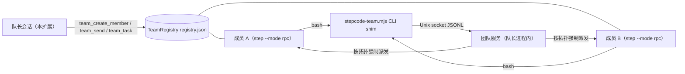

# Step-Code-Agent-Team

[Step Code](https://stepfun.com)（`step`）的智能体团队插件：当前会话成为**队长**，按需创建可续聊的**成员** Agent，把目标拆解为带依赖的**任务板**，并行调度成员执行，并支持成员间直达消息。

> **参考说明：** 本项目**参考了 DeepSeek Harness 的智能体团队（agent teams）功能**——队长/成员模型、带依赖的任务板、成员间消息均沿袭其设计。本插件是面向 Step Code 的独立实现，与 DeepSeek 无隶属关系。

[English →](./README.md)

## 工作原理



- **成员是真实的 `step` 进程**：独立上下文窗口、可配模型与工具白名单，通过 RPC 协议驱动。成员上下文持久化在 session 文件中，用同一 session-id 重启即可续聊。
- **任务板是 DAG**：`blockedBy` 全部完成的任务才 `ready`；成环的依赖在创建时即被拒绝。
- **成员间消息**：成员通过 `stepcode-team` CLI shim 连接队长进程内的 Unix socket 与队友通信；直达消息受**拓扑**约束（见下），默认星型下全部经由队长中转。
- **护栏**：最多 8 个成员；最多 5 个并发调度（超出则排队，轮到才启动）；单次调度 180s 超时；累计花费超 `STEPCODE_TEAM_COST_WARN`（默认 $1）时告警；空闲 30 分钟的成员被回收（session 保留可恢复）；队长退出时全部子进程被清理。

## 环境要求

- PATH 中可用的 `step` CLI。
- Node（shim 以 `node bin/stepcode-team.mjs` 方式调用）。
- 无第三方 npm 依赖。

## 安装

```bash
# 本地目录安装（写入 step 设置）
step install /path/to/Step-Code-Agent-Team

# 开发期：直接加载，无需安装
step -e ./extensions/index.ts
```

> **请从干净导出物安装，不要直接安装工作目录。** 本地路径安装会拷贝整个包目录
> （不尊重 `.gitignore`），会把 `local/`（凭证）与 `sandbox/`（开发状态）一并卷入。
> 在检出副本中：
>
> ```bash
> git archive HEAD | tar -x -C /tmp/step-code-agent-team && step install /tmp/step-code-agent-team
> ```

然后在会话里下达目标，例如："用智能体团队并行审查这个仓库"（或先运行 `/agent-team`——插件在此之前保持静默）。

## 激活机制（默认关闭）

插件在会话启动时**不激活**：团队工具对模型不可见，也不存在 socket、定时器或成员进程。两种触发方式：

1. **斜杠命令 `/agent-team`**：调用即激活，并展示团队板；
2. **自然语言**：prompt 文本命中激活关键词（如 "智能体团队"、"agent team"，可配置）。

激活后在本次会话内保持。完整配置见 [docs/CONFIGURATION.md](docs/CONFIGURATION.md)
（可整体禁用激活或调整关键词）。

## 工具

| 工具 | 用途 |
|---|---|
| `team_create_member` | 创建/恢复成员（`name`，可选 `role` 预设、`model`、`thinking`、`tools`、`systemPrompt`） |
| `team_send` | 给成员发消息并等待完整回复；可带 `taskId`（按任务执行）或 `mode: "oneshot"`（无状态） |
| `team_task` | 任务板：`create` / `start` / `complete` / `fail` / `list` |
| `team_status` | 成员、任务板、累计花费 |
| `team_disband` | 停止单个成员或全队（session 保留） |
| `team_set_topology` | 派活前声明成员通信拓扑（`star`/`pipeline`/`mesh`/`ring`/`custom`） |
| `/agent-team` | 命令：激活插件并查看团队板 |

## 成员通信拓扑

除非拓扑允许，成员之间的直达消息会被**拒绝**。队长在创建成员后、派活前，用 `team_set_topology` 按任务结构设计拓扑；默认为星型——全部经由队长中转。

| 形状 | 边 | 适用 |
|---|---|---|
| `star`（默认） | 无 | 并行独立、由队长汇总 |
| `pipeline` | m1→m2→…→mn（按创建顺序） | 顺序精炼（scout → planner → worker → reviewer） |
| `mesh` | 全部有序对 | 同伴互查 |
| `ring` | mi→mi+1（末位回环） | 环形流水 |
| `custom` | 显式 `{from, to}` 列表 | 精确控制 |

强制点在团队服务：每条消息携带发送方身份（spawn 时注入）并对照声明的边检查；越界会被拒绝并告知可用邻居，成员可执行 `stepcode-team status` 查询。配置 `topology.requireDeclaration: true` 后，未显式声明拓扑前禁止任何派活——字面落实“先设计再开工”。完整参考：[docs/CONFIGURATION.md](docs/CONFIGURATION.md)。

## 内置角色预设（`agents/`）

| 预设 | 工具 | 用途 |
|---|---|---|
| `scout` | 只读 | 代码勘察、结构化汇报 |
| `planner` | 只读 | 制定实施计划 |
| `worker` | 全量 | 执行计划、运行检查 |
| `reviewer` | 只读 | 对抗式审查（正确性 / 风格 / 安全） |

另附 `prompts/team-review.md`（并行多审查员链）与
`skills/team-orchestration/SKILL.md`（何时以及如何组队）。

## 开发沙箱

全部开发活动在 `sandbox/` 内进行（已 gitignore），与真实 `~/.stepcode`
配置、会话、项目完全隔离：

```bash
./sandbox/run.sh       # 以沙箱环境变量启动 step（cwd 为 sandbox/project）
bash sandbox/probe.sh  # 零 token 协议探针（期望输出 PROBE OK）
```

`run.sh` 会将 `STEP_CODING_AGENT_DIR`、`STEP_CODING_AGENT_SESSION_DIR`、
`STEP_CODING_AGENT_PLAN_DIR` 指向 `sandbox/agent/...`。涉及模型调用的运行前，
请在当前 shell `export STEP_API_KEY=<你的key>`——密钥绝不落盘。

## 项目结构

```
extensions/    index.ts（接线）· config.ts · activation.ts · rpc-client.ts ·
               members.ts · tasks.ts · registry.ts · team-server.ts ·
               presets.ts · tools.ts · render.ts
bin/           stepcode-team.mjs（成员侧 CLI shim）
agents/        角色预设（scout · planner · worker · reviewer）
prompts/       team-review.md
skills/        team-orchestration/SKILL.md
docs/          CONFIGURATION.md（配置参考）
sandbox/       隔离开发环境（gitignored）
```

## 配置

全部行为参数集中于 JSON 配置文件——全局 `<agentDir>/stepcode-agent-team.json`
（沙箱中 agentDir 指向 `sandbox/agent`）与可选的的项目级覆盖
`<cwd>/.stepcode/stepcode-agent-team.json`（仅项目被信任时加载）。
优先级：内置默认 < 全局 < 项目级 < 环境变量覆盖。

```jsonc
{
  "activation": { "enabled": true, "keywords": ["agent team", "智能体团队"], "notifyOnActivate": true },
  "models": { "available": ["step-5-preview"], "autonomousSelection": false, "autonomousThinking": false },
  "members": { "max": 8, "defaultRole": "worker", "defaultTools": null, "maxRecursionDepth": 1 },
  "dispatch": { "maxConcurrent": 5, "timeoutMs": 180000, "handshakeTimeoutMs": 15000, "retries": 1 },
  "oneshot": { "timeoutMs": 180000 },
  "cost": { "warnThreshold": 1 },
  "idle": { "reapAfterMs": 1800000, "reapIntervalMs": 300000 },
  "storage": { "dir": null },
  "debug": false
}
```

要点：`autonomousSelection` 关闭（默认）时所有成员使用对话当前模型；
`autonomousThinking` 关闭（默认）时成员思考强度默认为 `high`。
`members.maxRecursionDepth`（默认 1）界定团队树深度——调大后成员才能组建自己的
子团队；`dispatch.maxConcurrent`（默认 5）限制同时运行的成员数，超出的派活排队，
轮到且有空位时才启动成员进程。完整参考：
[docs/CONFIGURATION.md](docs/CONFIGURATION.md)。

环境变量覆盖：`STEPCODE_TEAM_DEBUG=1`（≡ `debug: true`）、
`STEPCODE_TEAM_COST_WARN=<usd>`（≡ `cost.warnThreshold`）。
`STEPCODE_TEAM_SOCK` 由队长自动注入成员进程。

## 开发

零 token 冒烟探针覆盖协议层行为（spawn、握手、注册表、任务图、socket 往返、预设），不调用任何模型：

```bash
bash sandbox/probe.sh   # RPC 握手探针 → 期望输出 PROBE OK

npm run smoke           # 零 token 冒烟集（test/smoke/phase1,2,3,5,6,7,8,9,13）
                        # hermetic：一次性临时 agentDir；phase5 未设 STEP_API_KEY 时
                        # 显式 SKIP（它会发起一次真实调用）
```

冒烟集随仓库分发（`test/smoke/` + `test/run-smoke.sh`，临时 agentDir 经 mktemp 创建）。
LLM 路径探针（`sandbox/smoke-phase4/10/11/12.ts`）需测试 key，仍留于 gitignore 的
`sandbox/`，详见 [docs/TESTING.md](docs/TESTING.md)。

> **无界面运行**：`step -p` 默认拦截会派生进程或修改工作区的工具；无人值守运行需加 `--approval-mode auto`（或 `--non-interactive-approval allow`）。

## 文档

| 文档 | 内容 |
|---|---|
| [docs/ARCHITECTURE.md](docs/ARCHITECTURE.md) | 组件、数据流、存储布局、护栏位置 |
| [docs/PROTOCOL.md](docs/PROTOCOL.md) | 成员 RPC 协议、socket 协议、registry schema、工具契约 |
| [docs/CONFIGURATION.md](docs/CONFIGURATION.md) | 配置参考 |
| [docs/TESTING.md](docs/TESTING.md) | 四层测试的运行方法 |

## 已知限制

- **项目级配置有两个时序妥协**：注册时固化的工具描述串（模型列表等）与本进程的深度门不随项目级配置刷新；生效深度上限经 `STEPCODE_TEAM_MAXDEPTH` 向子成员传播，描述变化下一会话生效。
- **LLM 行为不可完全控**：成员可能弃用工具转去排查环境；协调提示已加固，无法根除。
- **TUI 渲染未实测**：`render.ts` 只在交互 TUI 生效，headless 探针覆盖不到。
- **LLM 层探针在 gitignore 内**：`sandbox/smoke-phase4/10/11/12.ts` 与 `sandbox/TEST-PLAN.md` 未入库（零 token 层已随 `test/smoke/` 分发，`npm run smoke`）；换环境跑 LLM 层需按测试计划矩阵重建配置。
- **depth≥3 未做真实 LLM 链测试**（进程级已验证，构造上受深度上限约束）。

## 许可证

MIT — 见 [LICENSE](LICENSE)。

## 平台约束

本插件仅面向 **Step Code**，只使用标准扩展 API：`pi.registerTool` /
`pi.registerCommand` / `ctx.ui.notify` / 工具的 `renderCall` + `renderResult`
（pi-tui `Text`）/ `onUpdate` 流式回调。

它**不依赖** DeepSeek Harness 的 "better sidebar" 插件——也不依赖任何 DSH
专属插件——因为 Step Code 中不存在这些插件。未来如需类似侧边栏的界面，必须基于
Step Code 原生 API 实现，或置于可选接口之后：依赖缺失时自动退化为空操作，
核心团队功能不受影响。

## 状态与验证

开发计划 Phase 0–5 已全部实现。协议层行为（spawn、握手、注册表持久化、任务图、
socket 往返）已由零 token 冒烟探针（`sandbox/smoke-phase*.ts`）验证通过。
涉及模型调用的路径已在沙箱内用测试 key 验证通过（成员回复、同进程上下文记忆、按 session-id 重启恢复、经 shim 的成员间直达消息、队长工具调用端到端链路）。以下命令可供人工复验：

```bash
# 1. 启动沙箱会话（先设置密钥）
export STEP_API_KEY=<你的key>
./sandbox/run.sh

# 2. 在会话中依次让 LLM 执行：
#    a. "创建一个 reviewer 成员审查 sandbox/project/src/app.ts"
#       → 验证 team_create_member + team_send（真实 LLM 回复）
#    b. "用一句话向它总结你发现的问题"
#       → 验证成员上下文记忆（同一进程内多轮）
#    c. "/agent-team"
#       → 验证激活与团队板展示
#    d. "创建两个成员并行审查不同侧重，然后合并结论"
#       → 验证并行调度与结果合并
#    e. 退出后重新进入并恢复会话：
./sandbox/run.sh -r
#       然后 "给 reviewer 发消息：还记得你审查过什么吗？"
#       → 验证队长重启后按 session-id 恢复成员上下文

# 3. 成员间消息（双成员协作）：
#    创建 scout 与 worker，让 worker 通过 bash 调用：
#      node bin/stepcode-team.mjs msg --to scout --message "<问题>"
#    → 验证 shim → socket → server → 成员 的完整直达消息链路
```
